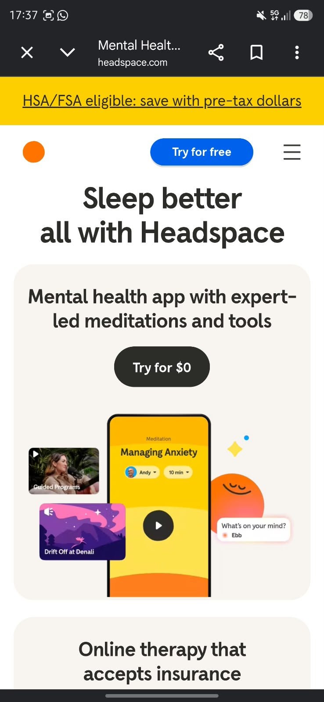
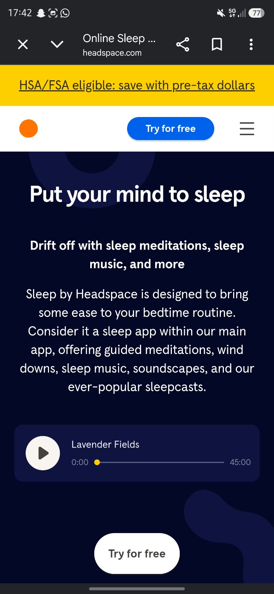
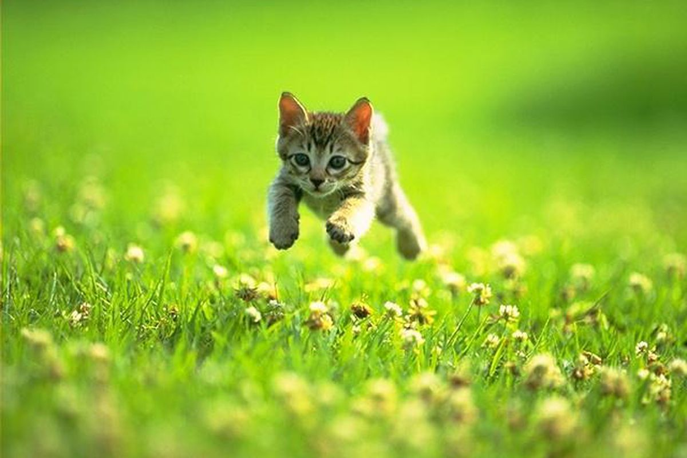

# Procesverslag
Markdown is een simpele manier om HTML te schrijven.  
Markdown cheat cheet: [Hulp bij het schrijven van Markdown](https://github.com/adam-p/markdown-here/wiki/Markdown-Cheatsheet).

Nb. De standaardstructuur en de spartaanse opmaak van de README.md zijn helemaal prima. Het gaat om de inhoud van je procesverslag. Besteedt de tijd voor pracht en praal aan je website.

Nb. Door *open* toe te voegen aan een *details* element kun je deze standaard open zetten. Fijn om dat steeds voor de relevante stuk(ken) te doen.

## Jij

  
uitwerken voor kick-off werkgroep

  ### Auteur:
  Lauren Cheung

  #### Je startniveau:
  Blauw

  #### Je focus:
  Responsive
 

## Je website

  
uitwerken voor kick-off werkgroep

  ### Je opdracht:
  https://www.headspace.com/

  #### Screenshot(s) van de eerste pagina (small screen): 
  Hoofdpagina  
  

  #### Screenshot(s) van de tweede pagina (small screen):
  hier de naam van de pagina  
  
 

## Toegankelijkheidstest 1/2 (week 1)

  
uitwerken na test in 2e werkgroep

  ### Bevindingen
  Lijst met je bevindingen die in de test naar voren kwamen:

Om inzicht te krijgen in de digitale toegankelijkheid van de Headspace-website, heb ik verschillende disability-simulatietests uitgevoerd. Hieronder staan de belangrijkste bevindingen per test.

---

### 1. Wazige bril (Visuele beperking / Lage gezichtsscherpte)
* **Kleine typografie:** Kleinere letters en secundaire teksten waren vanaf een normale werkafstand niet leesbaar; ik moest erg dicht naar het scherm toe buigen.
* **Muiscursor:** De cursor/pointer was lastig te volgen en raakte snel uit zicht tegen de achtergrond.
* **Animaties & Vormen:** Grote vlakken en bewegende elementen/animaties vielen juist wel goed op en bleven herkenbaar.

---

### 2. Bril met zwarte vlek (Centraal gezichtsveldverlies / Maculadegeneratie)
* **Layout & Vlakverdeling:** Door veel witruimte en grote blokken bleef het merendeel van de content bruikbaar en zichtbaar via het beperkte zicht.
* **Leesbaarheid:** De typografie op Headspace is over het algemeen ruim opgezet. Kleinere tekstblokken waren na enig scrollen en herpositioneren alsnog goed te lezen.

---

### 3. Schokapparaat (Motorische beperking / Tremoren & Parkinson-simulatie)
* **Fysieke interactie:** De aanhoudende trillingen/schokjes maakten nauwkeurig richten erg lastig. Typen leidde vaak tot fouten.
* **Nauwkeurigheid van de cursor:** Het trackpad bedienen vereiste veel concentratie; kleine interactieve knoppen en targets waren lastig accuraat aan te klikken.
* **Hover-states:** Elementen die direct reageren op hover activeerden soms per ongeluk doordat de cursor wegglipte naar omliggende links.
* **Scrollen:** Lineair scrollen door de content verliep wel soepel.

---

### 4. Screenreader / VoiceOver (Auditieve navigatie voor blinden en slechtzienden)
* **Tekst & Structuur:** De screenreader leest bodyteksten, navigatielijsten en links helder op en geeft de structuur (bijv. lijsten) goed aan.
* **Tekstinvoer:** Tijdens het typen wordt elke letter en aansluitend het hele woord auditief bevestigd.
* **Gevonden knelpunten:**
  * **Sponsors/Partners:** Sommige visuele onderdelen (zoals sponsor- of partnerlogo's) werden overgeslagen of misten een duidelijke beschrijving (`alt`-tekst).
  * **Headings:** Bij bepaalde koppen werd wel aangekondigd dat het om een *heading* ging, maar werd de feitelijke tekstinhoud niet goed voorgelezen.
  * **Irrelevante groeperingen:** De lezer benoemde meerdere keren algemene HTML-groepen/containers, wat voor ruis en verwarring zorgde.
  * **Terugkeren naar navigatie:** Vanaf de onderkant van de pagina weer omhoog navigeren kostte veel tijd en vereiste het doorlopen van tientallen tussenliggende elementen; er ontbrak een duidelijke *back to top* of semantisch skip-mechanisme.

## Breakdownschets (week 1)

  
uitwerken na afloop 3e werkgroep

  ### de hele pagina: 
  

  ### dynamisch deel (bijv menu): 
  

  ### wellicht nog een dynamisch deel (bijv filter): 
  

## Voortgang 1 (week 2)

  
uitwerken voor 1e voortgang

  ### Stand van zaken
  hier dit ging goed & dit was lastig (neem ook screenshots op van delen van je website en code)

  ### Agenda voor meeting
  samen met je groepje opstellen

  | student 1      | student 2          | student 3    | student 4        |
  | ---            | ---                | ---          | ---              |
  | dit bespreken  | en dit             | en ik dit    | en dan ik dat    |
  | en dat ook nog | dit als er tijd is | nog een punt | dit wil ik zeker |
  | ...            | ...                | ...          | ...              |

  ### Verslag van meeting
  hier na afloop snel de uitkomsten van de meeting vastleggen

  - punt 1
  - punt 2
  - nog een punt
  - ...

## Voortgang 2 (week 3)

  
uitwerken voor 2e voortgang

  ### Stand van zaken
  hier dit ging goed & dit was lastig (neem ook screenshots op van delen van je website en code)

  ### Agenda voor meeting
  samen met je groepje opstellen

  | student 1      | student 2          | student 3    | student 4        |
  | ---            | ---                | ---          | ---              |
  | dit bespreken  | en dit             | en ik dit    | en dan ik dat    |
  | en dat ook nog | dit als er tijd is | nog een punt | dit wil ik zeker |
  | ...            | ...                | ...          | ...              |

  ### Verslag van meeting
  hier na afloop snel de uitkomsten van de meeting vastleggen

  - punt 1
  - punt 2
  - nog een punt
- ...

## Toegankelijkheidstest 2/2 (week 4)

  
uitwerken na test in 9e werkgroep

  ### Bevindingen
  Lijst met je bevindingen die in de test naar voren kwamen (geef ook aan wat er verbeterd is):

## Voortgang 3 (week 4)

  
uitwerken voor 3e voortgang

  ### Stand van zaken
  hier dit ging goed & dit was lastig (neem ook screenshots op van delen van je website en code)

  ### Agenda voor meeting
  samen met je groepje opstellen

  | student 1      | student 2          | student 3    | student 4        |
  | ---            | ---                | ---          | ---              |
  | dit bespreken  | en dit             | en ik dit    | en dan ik dat    |
  | en dat ook nog | dit als er tijd is | nog een punt | dit wil ik zeker |
  | ...            | ...                | ...          | ...              |

  ### Verslag van meeting
  hier na afloop snel de uitkomsten van de meeting vastleggen

  - punt 1
  - punt 2
  - nog een punt
  - ...

## Eindgesprek (week 5)

  
uitwerken voor eindgesprek

  ### Je uitkomst - karakteristiek screenshots:
  

  ### Dit ging goed/Heb ik geleerd: 
  Korte omschrijving met plaatjes

  

  ### Dit was lastig/Is niet gelukt:
  Korte omschrijving met plaatjes

  

## Bronnenlijst

  
continu bijhouden terwijl je werkt

  Nb. Wees specifiek ('css-tricks' als bron is bijv. niet specifiek genoeg). 
  Nb. ChatGpT en andere AI horen er ook bij.
  Nb. Vermeld de bronnen ook in je code.

  1. bron 1
  2. bron 2
  3. ...

