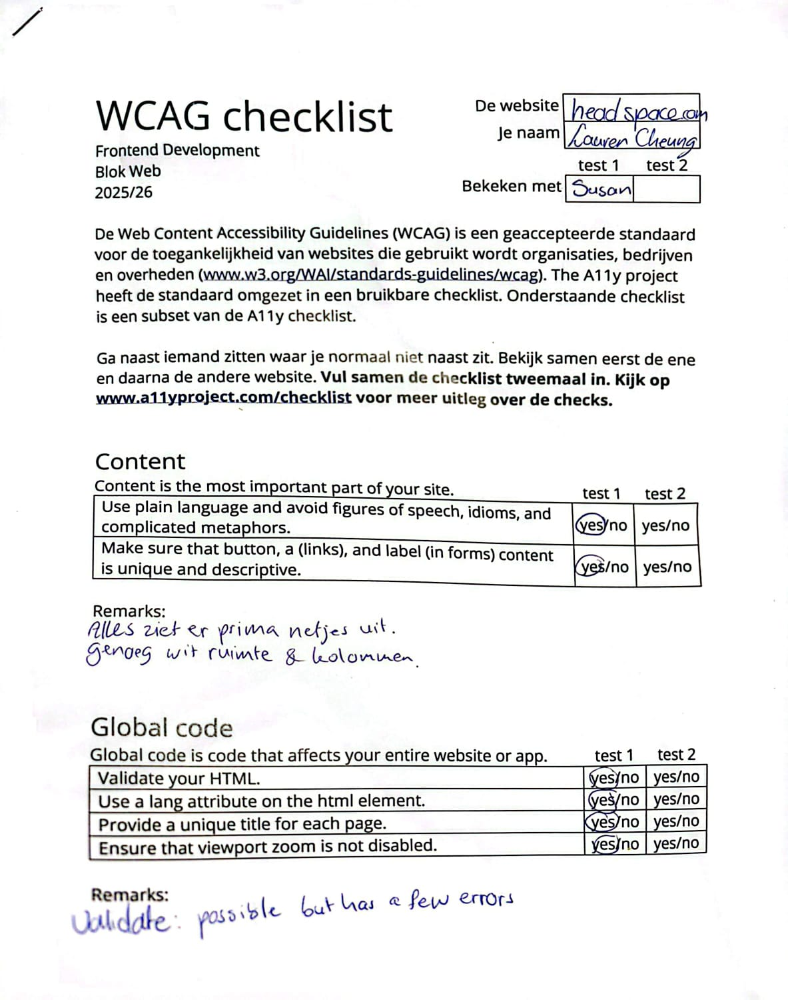
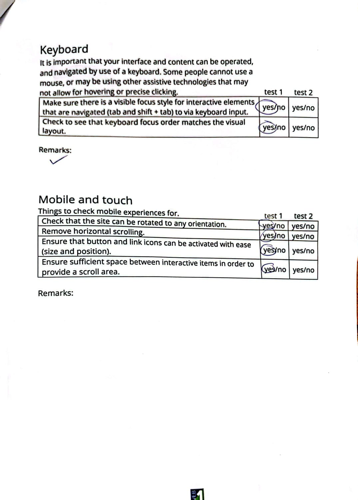
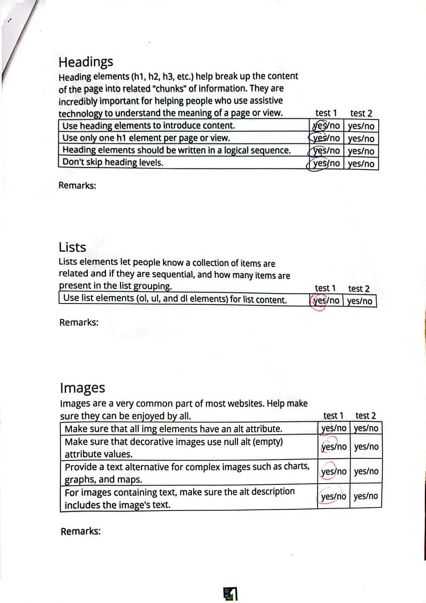
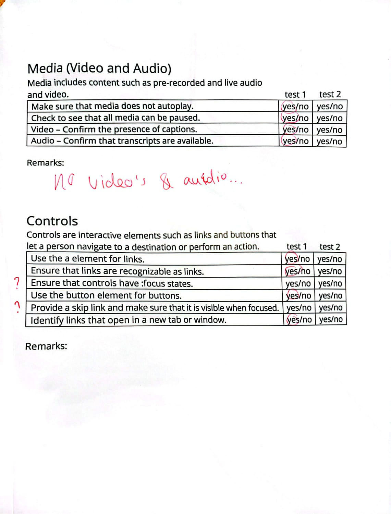
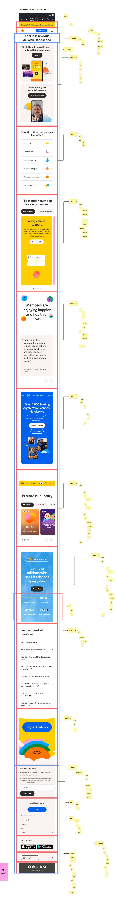
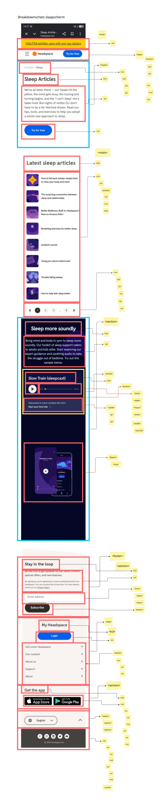
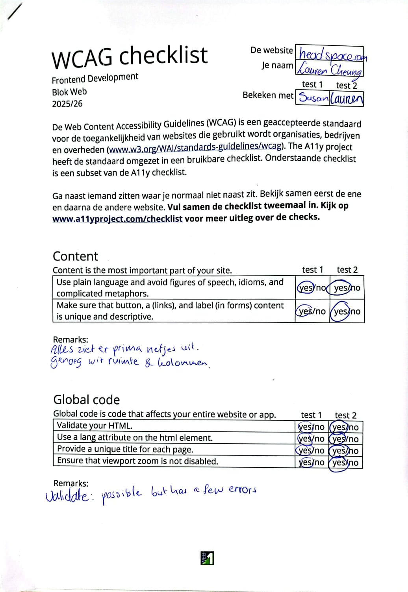
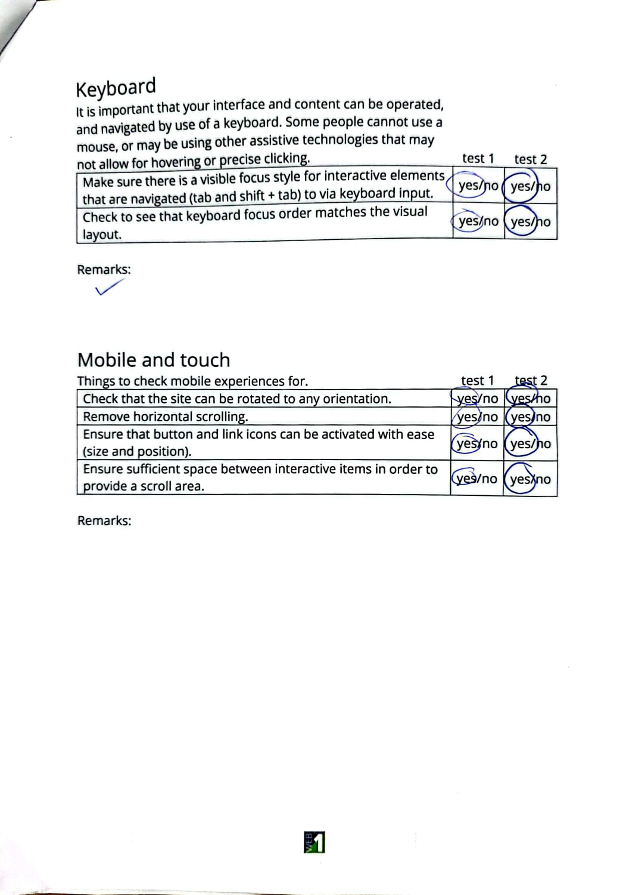
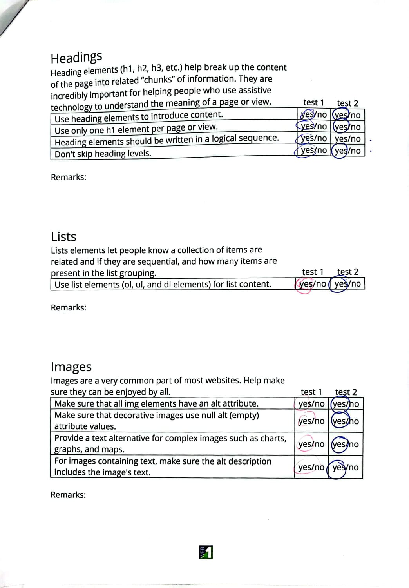
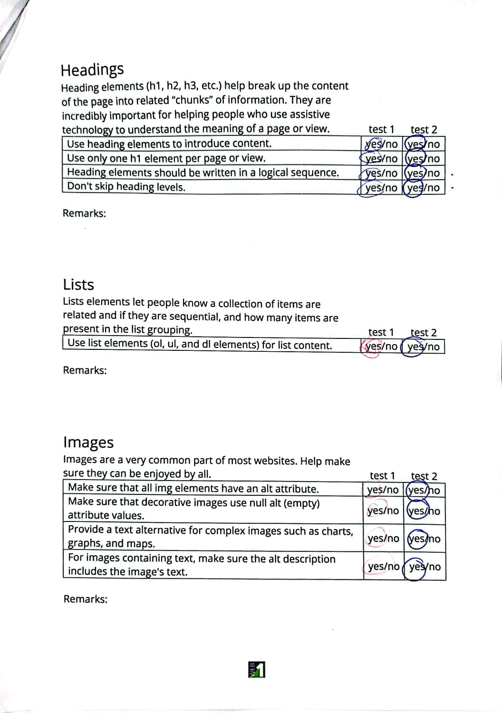

# Procesverslag

## Jij

  
Metadata

  ### Metadata:
  - Naam: Lauren Cheung
  - Studentnummer: 500836027
  - Datum:20/11/2026
  - Vak: Inhaal Frontend
  - Docent: Danny de Vries

  #### Mijn startniveau:
  Blauw

  #### Mijn focus:
  Responsiveness

  ### Achtergrond & proces:
  Ik heb dit vak in eerdere jaren vaker geprobeerd maar niet afgemaakt omdat coderen voor mij erg lastig en vaak
  frustrerend kan zijn, en ik af en toe nog last heb van faalangst en perfectionisme. Wanneer iets lukt is het juist
  heel leuk, maar als ik vastloop en er niet uitkom slaat de frustratie en twijfel snel toe. Omdat het curriculum is
  gewijzigd en dit mijn laatste kans is om deze studiepunten te halen, wil en zal ik dit vak nu halen en heb ik er alles
  aan gedaan om de website af te ronden.
  

## Je website

  
uitwerking voor kick-off werkgroep

  ### Je opdracht:
  Gekozen website: https://www.headspace.com/ (eerder Ticketmaster opnieuw overwogen vanwege vorige jaren, maar Headspace gekozen op advies om een website te kiezen die me enigszins leuk lijkt.)

  #### Screenshot van de eerste pagina (small screen): 
  - 'Home' pagina  
  

  #### Screenshot van de tweede pagina (small screen):
  - 'Sleep' pagina
  
 

## Week 1 — Website kiezen, toegankelijkheidstest & breakdownschets

  
Proces update week 1

  ### Wat ik heb gedaan
- Ik heb gekozen voor Headspace (in plaats van Ticketmaster), omdat een website die ik er leuk uit vond zien me meer zou motiveren om ermee aan de slag te gaan.
- Ik heb tijdens de les een toegankelijkheidstest gedaan met behulp van verschillende middelen om de Headspae website te testen.
- Ik ben begonnen met de **breakdownschets** om te zien hoe de pagina's en verschillende onderdelen opgebouwd zijn. Al snel werd duidelijk dat Headspace behoorlijk wat secties en interactieve elementen heeft, wat het qua uitwerking best uitdagend maakt.

### Toegankelijkheidstest 1/2 (week 1)
Om inzicht te krijgen in de digitale toegankelijkheid van de Headspace-website heb ik verschillende disability-simulatietests uitgevoerd. Hieronder staan de belangrijkste bevindingen per test:

1. **Wazige bril (Visuele beperking / Lage gezichtsscherpte)**
   - **Kleine typografie:** Kleinere letters en secundaire teksten waren vanaf een normale werkafstand niet leesbaar; ik moest erg dicht naar het scherm toe buigen.
   - **Muiscursor:** De cursor/pointer was lastig te volgen en raakte snel uit zicht tegen de achtergrond.
   - **Animaties & Vormen:** Grote vlakken en bewegende elementen/animaties vielen juist wel goed op en bleven herkenbaar.

2. **Bril met zwarte vlek (Centraal gezichtsveldverlies / Maculadegeneratie)**
   - **Layout & Vlakverdeling:** Door veel witruimte en grote blokken bleef het merendeel van de content bruikbaar en zichtbaar via het beperkte zicht.
   - **Leesbaarheid:** De typografie op Headspace is over het algemeen ruim opgezet. Kleinere tekstblokken waren na enig scrollen en herpositioneren alsnog goed te lezen.

3. **Schokapparaat (Motorische beperking / Tremoren & Parkinson-simulatie)**
   - **Fysieke interactie:** De aanhoudende trillingen/schokjes maakten nauwkeurig richten erg lastig. Typen leidde vaak tot fouten.
   - **Nauwkeurigheid van de cursor:** Het trackpad bedienen vereiste veel concentratie; kleine interactieve knoppen en targets waren lastig accuraat aan te klikken.
   - **Hover-states:** Elementen die direct reageren op hover activeerden soms per ongeluk doordat de cursor wegglipte naar omliggende links.
   - **Scrollen:** Lineair scrollen door de content verliep wel soepel.

4. **Screenreader / VoiceOver (Auditieve navigatie voor blinden en slechtzienden)**
   - **Tekst & Structuur:** De screenreader leest bodyteksten, navigatielijsten en links helder op en geeft de structuur (bijv. lijsten) goed aan.
   - **Tekstinvoer:** Tijdens het typen wordt elke letter en aansluitend het hele woord auditief bevestigd.
   - **Gevonden knelpunten:**
     - **Sponsors/Partners:** Sommige visuele onderdelen (zoals sponsor- of partnerlogo's) werden overgeslagen of misten een duidelijke beschrijving (`alt`-tekst).
     - **Headings:** Bij bepaalde koppen werd wel aangekondigd dat het om een heading ging, maar werd de feitelijke tekstinhoud niet goed voorgelezen.
     - **Irrelevante groeperingen:** De lezer benoemde meerdere keren algemene HTML-groepen/containers, wat voor ruis en verwarring zorgde.
     - **Terugkeren naar navigatie:** Vanaf de onderkant van de pagina weer omhoog navigeren kostte veel tijd en vereiste het doorlopen van tientallen tussenliggende elementen; er ontbrak een duidelijke back to top of semantisch skip-mechanisme.

### WCAG checklist - Test 1 (uitgevoerd door klasgenoot Susan)

De eerste toegankelijkheidstest is uitgevoerd door mijn klasgenoot Susan aan de hand van de WCAG-checklist. Over het algemeen zag de website er volgens haar al erg netjes en verzorgd uit, met voldoende witruimte en een duidelijke indeling. De meeste punten stonden dan ook direct op 'yes'.

Wel kwamen er een paar kleine aandachtspunten naar voren:
- **HTML-validatie:** De validator gaf nog een klein aantal foutmeldingen (*"possible, but has a few errors"*).
- **Appearance (Dark mode):** Ondersteuning voor *dark mode* en *high-contrast mode* niet aanwezig.
- **Overig:** Op het moment van testen stonden er geen audiofragmenten op de pagina (waardoor het onderdeel *Media* nog niet van toepassing was.

### Breakdownschetsen

  ### Hoofdpagina: 
  

  ### Slaappagina: 
  

  ### Mentale stand & update
Ik begon deze nieuwe poging met goede moed omdat Headspace er aantrekkelijk uitzag en ik een frisse start wilde maken. Tegelijk voelde ik bij het zien van alle onderdelen al wel dat het best een pittige kluif ging worden, zeker omdat coderen me niet vanzelf afgaat.

## Week 2 — Voortgangsgesprek, verder breakdownschets & begin HTML

  
Proces update week 2

  ### Wat ik heb gedaan
- Ik heb het voortgangsgesprek gehad en feedback gekregen op mijn breakdownschets: over het algemeen zat het goed, maar een aantal onderdelen mochten meer in detail en ik kreeg tips over welke HTML-elementen ik beter wel of niet kon gebruiken.
- Op basis van die feedback heb ik mijn breakdownschets verder uitgewerkt en ben ik begonnen met het schrijven van de HTML.
- Omdat het al een tijd geleden was dat ik een codeervak had gevolgd, zat de basis nog niet zo in mijn vingers dat ik die zomaar snel in elkaar zette.

### Mentale stand & update
Mijn perfectionisme speelde hier meteen mee: omdat ik wist dat HTML de basis is van de website, wilde ik het tot in de puntjes op orde hebben voordat ik verder ging. Daardoor kostte het veel tijd, liep ik al vroeg iets achter op het tempo van de lessen en kon ik klasoefeningen/popdrachten niet direct op mijn eigen site toepassen, wat ik jammer vond, al besefte ik dat ik daar zelf ook een rol in had door mijn trage start.

## Week 3 — Verder HTML

  
Proces update week 3

  ### Wat ik heb gedaan
- In week 3 ben ik verder gegaan met het schrijven en uitbreiden van mijn vanilla HTML voor de pagina's.
- Ik heb geprobeerd de structuur helder en compleet neer te zetten, terwijl ik merkte dat ik nog steeds veel tijd kwijt was aan het netjes maken van de basis.
- Ik heb niet aan alle voortgangsgesprekken deelgenomen wanneer ik nog weinig had om concrete feedback op te vragen en ben in plaats daarvan zelfstandig doorgegaan.

### Mentale stand & update
De drempel voor dit vak zat bij mij best hoog, mede omdat ik het eerder meerdere keren niet had afgemaakt. Toch hield ik mezelf voor dat ik nu niet te snel wilde opgeven en stap voor stap door moest blijven werken aan de basis.

## Week 4 - HTML afronden & begin CSS

  
Proces update week 4

  ### Wat ik heb gedaan
- Ik heb mijn HTML verder afgerond en ben begonnen met CSS.
- Al snel merkte ik dat CSS nog meer tijd en geduld kostte dan HTML. Veel onderdelen lukten, maar andere wilden totaal niet meewerken.

### Mentale stand & update
Ik dacht dat ik lang over HTML had gedaan, maar met CSS kwam er nog meer frustratie bij kijken. Zodra ik ergens niet uitkwam, merkte ik dat twijfel en ongeduld sneller opspeelden, al gaf een werkend stukje af en toe ook weer motivatie.

## Week 5 — CSS

  
Proces update week 5

  ### Wat ik heb gedaan
- In week 5 heb ik intensief aan de CSS gewerkt en veel geworsteld met positionering.
- Vooral de navigatie was lastig: ik paste één ding aan en meteen versprong er op allerlei plekken iets anders. Mijn vaste strategie was om met Ctrl+Z terug te gaan voordat alles volledig in de war stond en dan opnieuw te kijken.
- Met de **carrousels** had ik ook veel moeite; één carrousel op de hoofdpagina bleef dwarsliggen ondanks dat ik dacht dat mijn code klopte. Uiteindelijk heb ik bewust besloten om daar niet in te blijven vastlopen en door te gaan met de rest van de website.

### Mentale stand & update
Dit was een zware en soms echt frustrerende week: het gevoel dat ik niet codeer-getalenteerd ben en dat alles verspringt kan dan flink aan me trekken. Het loslaten van die ene vastgelopen carrousel en het gebruik van Ctrl+Z hielp om niet helemaal te verzuipen en toch verder te komen.

## Week 6 — CSS & JavaScript (en bijlessen met mijn neef)

  
Proces update week 6

  ### Wat ik heb gedaan
- In week 6 ben ik naast CSS ook met JS aan de slag gegaan, wat grotendeels nieuw voor mij was.
- Omdat ik tijdens de lessen niet altijd goed kon focussen, heb ik veel YouTube video's bekeken en uitleg/bijles gevraagd aan mijn neef (software engineering, in Londen). Videobellen en snel feedback vragen was door de afstand en drukte lastig, maar zijn uitleg hielp me om logica en concepten beter te snappen.
- Ik heb soms express JS gebruikt ipv CSS, omdat ik bang was dat alles weer zou verschuiven.

### Bijlesnotities met mijn neef (Londen — software engineering)
- **Selectors & states:** Hoe je elementen gericht selecteert en met `disabled` of states aangeeft wanneer een knop wel of niet bruikbaar is.
- **Scrollen & breedtes:** Hoe `scrollLeft`, `clientWidth` en `scrollWidth` werken om te bepalen waar je in een scrollbare lijst zit, en waarom een kleine marge helpt tegen afrondingsverschillen.
- **Tickers / herhalende strips:** Hoe herhalende lijsten en animaties (`translateX`) zorgen voor een doorlopende beweging en waar je op moet letten bij spacing en `aria-hidden="true"`.

### Mentale stand & update
Omdat ik mijn eerste deadline niet had gehaald en dit mijn laatste kans is met het vernieuwde curriculum, voelde ik veel druk om het nu echt te halen. Tegelijk gaf de uitleg van mijn neef en het zien werken van onderdelen me weer wat meer houvast en motivatie om door te strijden.

## Week 7 — CSS & JS, code opschonen, toegankelijkheid checken in code, toegankelijkheidstest 2/2

Proces update week 7

### Wat ik heb gedaan
- **CSS & JS afronden:** Nog de laatste CSS- en JS-aanpassingen gedaan en gecontroleerd of alles werkt zoals bedoeld.
- **Code opschonen:** Omdat mijn code op een gegeven moment aanvoelde als een soort soep waarin ik dingen moeilijk terugvond (bijna alsof ik code-dyslexie had), heb ik opgezocht hoe ik het beste comments kan schrijven en mijn code netjes opgeschoond en van commentaar voorzien.
- **Toegankelijkheid checken in code:** Ik ben mijn hele code nagelopen op toegankelijkheid: `alt`-teksten, buttons, `aria`-labels, `aria-hidden`, audio-onderdelen, links en de taal van de website. Daarbij heb ik ander andere ook Nederlandse stukjes in mijn Engelstalige website aangepast zodat alles kloppend en leesbaar is voor een screenreader.
- 2e toegankelijkheidstest afgenomen
- **Oplevering:** Bestanden en verwijzingen nagelopen, deze `README.md` bijgewerkt en de website op GitHub / DLO klaargezet voor de herkansing en het eindgesprek.

### WCAG checklist - Test 2 (uitgevoerd door mijzelf)

De tweede toegankelijkheidstest heb ik zelf uitgevoerd nadat ik de volledige website had afgerond.

**Resultaten van de controle:**
- **Code & Validatie:** Ik heb in VS Code gecontroleerd of er nog errors in mijn code aanwezig zijn en alles is nu foutloos.
- **Media (Audio):** De audiofragmenten zijn op de pagina's te vinden, spelen niet automatisch af (`autoplay` staat uit) en kunnen met een knop worden gepauzeerd.

**Bewuste keuzes (conform origineel):**
- **Appearance (Dark & high-contrast mode):** Net als op de originele Headspace-website heb ik geen *dark mode* of aparte *high-contrast mode* gebouwd, maar de vaste lichte huisstijl aangehouden.
- **Audio-transcripties:** Bij de audiofragmenten ontbreken uitgeschreven transcripties, omdat deze op de originele pagina ook niet aanwezig zijn.

### Mentale stand & update
Ik merk dat ik er alles op zet om deze herkansing te halen ook al kostte me dit een paar mental breakdowns, want het zou zonde zijn als al deze tijd en moeite voor niets is geweest. Door mijn code op te schonen en van duidelijke comments te voorzien voelt het geheel nu veel rustiger en overzichtelijker dan aan het begin van het puzzelen.

## Bronnenlijst

  
Bronnen

  ## Bronnen

### Assets & Referentie
* **Functionele & visuele referentie, afbeeldingen, SVG's, audio en `Headspace Apercu`-lettertypen:** [Headspace](https://www.headspace.com/)

### HTML, CSS & JavaScript Documentatie
* **HTML-elementen naslag:** [MDN Web Docs – HTML elements reference](https://developer.mozilla.org/en-US/docs/Web/HTML/Reference/Elements)
* **CSS-eigenschappen naslag:** [CSS-Tricks – CSS Almanac](https://css-tricks.com/almanac/)
* **Flexbox-gids:** [CSS-Tricks – A Complete Guide to Flexbox](https://css-tricks.com/snippets/css/a-guide-to-flexbox/)
* **Toegankelijkheid & Validatie:** [W3C Markup Validation Service](https://validator.w3.org/) & [The A11Y Project Checklist](https://www.a11yproject.com/checklist/)

### Tutorials & Video's
* **HTML-opfrisser:** [YouTube – HTML Tutorial for Beginners](https://www.youtube.com/watch?v=qz0aGYrrlhU)
* **CSS-kernprincipes:** [YouTube – CSS Tutorial](https://www.youtube.com/watch?v=JnTPd9G6hoY)
* **JavaScript-opfrisser:** [YouTube – JavaScript Tutorial for Beginners](https://www.youtube.com/watch?v=W6NZfCO5SIk)

### Overige ondersteuning
* **Bijles & uitleg over JavaScript-concepten:** Neef (software engineer)
* **Hulp bij logica/uitleg en commentaarstructuur:** [Google Gemini](https://gemini.google.com/app)

